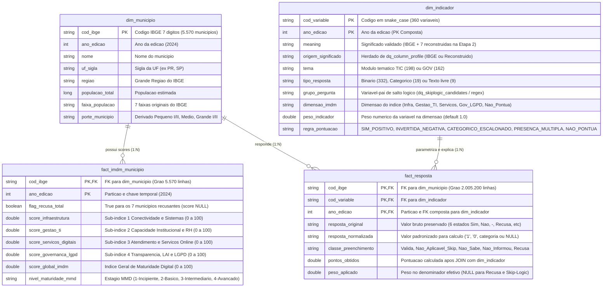

# Especificação do Modelo Dimensional, Regras de Pontuação e Camada Semântica (Etapa 3)
**Projeto:** Índice de Maturidade Digital Municipal (IMDM) — MUNIC 2024 (SGD/MGI)  
**Catálogo Unity Catalog:** `munic_catalog`  
**Schemas Alvo:** `silver` (ajuste de pré-requisito), `gold` e `semantic`  
**Alinhamento de Governança:** COBIT 2019 (APO03.02, APO14.02, APO14.03, APO14.07, BAI03.02, MEA01.03) e CMMI-DMM (Modelo de Maturidade de Dados)

---

## 1. Contexto e Decisões de Arquitetura (Pós-Revisão e Achados da Etapa 2)

A modelagem dimensional da Etapa 3 apoia-se diretamente nas evidências empíricas produzidas na Etapa 2 sobre a base `Base_MUNIC_2024_20251107.xlsx` (**5.570** municípios × **360** variáveis temáticas = **2.005.200** observações, sendo **198** de `Informática e comunicação` e **162** de `Governança`):

1. **Reversão do Cast Destrutivo na Camada Silver (Pré-requisito Crítico de Acurácia e Completude):**
   * Na Etapa 2 (Seção 3.1), comprovou-se que as **2.005.200** células dividem-se em **6 estados mutuamente exclusivos**:
     * Resposta válida (`Sim`, `Não`, categorias ou texto): **1.493.935** (74,50%)
     * Não aplicável (`-`, ausência estrutural por salto lógico/*skip-logic* em 207 colunas): **500.916** (24,98%)
     * `Não informou`: **4.413** (0,22%)
     * `Não sabe informar`: **3.416** (0,17% — concentrado no bloco de LGPD, como `mgov32` com 857 municípios)
     * `Recusa`: **2.520** (0,13% — exatamente os 7 municípios recusantes: Xapuri/AC, Colares/PA, Vigia/PA, Buriti/MA, Carolina/MA, Santa Cecília/SC e Bagé/RS)
     * Nulo técnico: **0** (0,00%)
   * Converter cegamente os códigos de ausência para `NULL` e as respostas para `boolean` na camada Silver apaga a evidência de acurácia validada contra o IBGE e impede distinguir quem **não sabe informar sobre LGPD** (indicador real de baixa maturidade institucional) de quem **sofreu salto lógico (`-`)**. A Silver passa a preservar o texto original limpo.

2. **Separação entre Fato Analítica de BI (`fact_imdm_municipio`) e Fato de Auditoria (`fact_resposta`):**
   * Uma tabela despivotada de **2.005.200** linhas contendo strings (`"Sim"`, `"Não"`) configura um padrão EAV (*Entity-Attribute-Value*) sem medidas aditivas diretas e excede o limite de **100.000** linhas por dataset dos painéis AI/BI do Databricks.
   * Portanto, `fact_imdm_municipio` (**5.570** linhas, com scores numéricos aditivos e cluster) assume o papel de **fato central do dashboard**, enquanto `fact_resposta` (**2.005.200** linhas) assume o papel de **rastreabilidade e auditoria por variável**.

3. **Construção Automatizada da `dim_indicador` a partir dos Artefatos da Etapa 2:**
   * Em vez de montar metadados do zero, a `dim_indicador` reutiliza via `JOIN` os ativos já materializados na Etapa 2 (`silver.munic_clean_dict`, `gold.dq_column_profile` e `gold.dq_skiplogic_candidates`), incorporando as correções documentais descobertas pelo grupo (as 7 variáveis reconstruídas ausentes do dicionário original do IBGE e a correção semântica de `mtic30` de "educação" para "comunicação").

---

## 1.1. Checklist de Reajustes Obrigatórios antes de Codar o `silver_to_gold` (Plano de Transição)

Para que o notebook `pipeline/silver_to_gold` execute sem falhas de tipagem ou perda de linhagem, os seguintes reajustes técnicos devem ser aplicados na infraestrutura atual:

### Ajuste 1: Refatoração da Função `treat_survey_indicators` no Notebook `bronze_to_silver`
* **Como estava na Etapa 2:** As colunas classificadas como binárias (`{"Sim", "Não"}`) sofriam cast para `BooleanType` (`true`/`false`), e os 4 códigos de ausência (`"-"`, `"Recusa"`, `"Não informou"`, `"Não sabe informar"`) eram todos convertidos para `NULL`.
* **O que mudar na Silver agora:**
  1. Manter todas as **360** colunas de indicadores como `StringType` higienizadas com `F.trim()`, preservando os **6 estados textuais originais** (`"Sim"`, `"Não"`, `"-"`, `"Não sabe informar"`, `"Não informou"`, `"Recusa"`).
  2. Converter para `NULL` apenas eventuais strings vazias `""` ou espaços em branco puros.
  3. Reexecutar o `bronze_to_silver` com `.option("overwriteSchema", "true")` e registrar no `userMetadata`: `"Refatoracao Pos-Revisao Etapa 3: Preservacao dos 6 estados originais da MUNIC"`.
  4. **Validação imediata pós-ajuste:** Garantir que a soma de células com valor `"Recusa"` na `silver.munic_clean_data` volte a ser exatamente **2.520** (7 municípios × 360 variáveis).

### Ajuste 2: Consolidação do Dicionário Silver (`silver.munic_clean_dict`) com os Achados de Qualidade
* **Como estava na Etapa 2:** A tabela `silver.munic_clean_dict` continha apenas `cod_variable`, `ano_edicao` e `meaning` extraídos da aba Dicionário da Bronze (onde faltavam 7 variáveis existentes nos dados e sobravam 5 códigos sem coluna), enquanto o perfilamento completo das 360 variáveis reais estava em `gold.dq_column_profile`.
* **O que mudar na passagem para a Gold:**
  1. Na criação da `gold.dim_indicador`, usar a lista oficial das **360 colunas de indicadores presentes em `silver.munic_clean_data`** (via `gold.dq_column_profile`) como base esquerda do `JOIN`.
  2. Garantir que as **7 variáveis reconstruídas na Etapa 2** (`mtic11`, `mtic31`, `mtic331`, `mtic2421`, `mtic2431`, `mgov141`, `mgov142`) e a correção textual de `mtic30` (Comunicação em vez de Educação) estejam preenchidas sem `NULL` na coluna `meaning`.
  3. Descartar os 5 códigos fantasmas do dicionário do IBGE que não possuem coluna nas abas de dados.

### Ajuste 3: Reorganização Lógica do Schema `gold` e Criação do Schema `semantic`
* **Situação atual do catálogo:** O schema `munic_catalog.gold` já armazena as 4 tabelas de diagnóstico da Etapa 2 (`dq_column_profile`, `dq_dimension_summary`, `dq_nonresponse_by_size`, `dq_skiplogic_candidates`).
* **O que preparar no ambiente (`environment/env_variables`):**
  1. Manter as tabelas `dq_*` intactas (pois `dq_column_profile` e `dq_skiplogic_candidates` serão lidas pelo `silver_to_gold` para enriquecer a `dim_indicador` automaticamente).
  2. Garantir a criação do schema `CREATE SCHEMA IF NOT EXISTS munic_catalog.semantic;` no arquivo de configuração de ambiente para receber as views agregadas do notebook `gold_to_semantic`.

---

## 2. Diagrama Entidade-Relacionamento (Modelo Físico/Lógico Gold)



---

## 3. Especificação Detalhada das Tabelas

### 3.1. Dimensão Município (`munic_catalog.gold.dim_municipio`)
* **Granularidade:** 1 linha por município (5.570 linhas).
* **Origem:** Colunas cadastrais e descritivas de `silver.munic_clean_data`.
* **Regra de Derivação (`porte_municipio`):**
  * `Pequeno I`: até 20.000 habitantes.
  * `Pequeno II`: de 20.001 a 50.000 habitantes.
  * `Médio`: de 50.001 a 100.000 habitantes.
  * `Grande I`: de 100.001 a 500.000 habitantes.
  * `Grande II`: mais de 500.000 habitantes.

---

### 3.2. Dimensão Indicador e Regras de Negócio (`munic_catalog.gold.dim_indicador`)
* **Granularidade:** 1 linha por variável por edição (360 linhas por edição para 2024: 198 de TIC e 162 de GOV).
* **Chave Primária Composta:** `(cod_variable, ano_edicao)`.
* **Papel na Governança:** Atua simultaneamente como Glossário de Negócios Ativo (COBIT APO14.02) e Tabela de Parametrização de Cálculo. Alterar o peso ou a regra de um indicador exige apenas atualizar esta tabela, mantendo o código do pipeline imutável.

#### 3.2.1. Linhagem e Origem de Cada Atributo da `dim_indicador`

| Coluna na `dim_indicador` | Fonte / Tabela de Origem | Como é Obtida (Regra Técnica) |
| :--- | :--- | :--- |
| **`cod_variable`** (PK) | `silver.munic_clean_dict` ⋈ `gold.dq_column_profile` | Código padronizado em minúsculas (`mtic011` a `mgov36`). Garante a cobertura exata das 360 variáveis dos dados. |
| **`ano_edicao`** (PK) | `silver.munic_clean_dict` | Inteiro `2024` (compõe a chave primária para suportar evolução semântica entre edições). |
| **`meaning`** | `gold.dq_column_profile.significado` | Incorpora as descrições do IBGE + as **7 variáveis reconstruídas na Etapa 2** (`mtic11`, `mtic31`, `mtic331`, `mtic2421`, `mtic2431`, `mgov141`, `mgov142`) + a correção documental de `mtic30` (Comunicação). |
| **`origem_significado`** | `gold.dq_column_profile.origem_significado` | Rastreia se o significado veio do dicionário oficial do IBGE ou da reconstrução analítica da Etapa 2. |
| **`tema`** | Derivada via prefixo de `cod_variable` | `WHEN startswith('mtic') THEN 'TIC'` (198 variáveis) `WHEN startswith('mgov') THEN 'GOV'` (162 variáveis). |
| **`tipo_detectado`** | `gold.dq_column_profile.tipo_detectado` | Classificação empírica da Etapa 2: `Binário` (332), `Categórico` (19) ou `Texto livre` (9). |
| **`grupo_pergunta`** | `gold.dq_skiplogic_candidates.coluna_pai_candidata` + Regex | Se a variável possui pai confirmado na tabela `dq_skiplogic_candidates` (133 relações determinísticas/confirmadas), usa `coluna_pai_candidata` (ex.: `mgov33` → `mgov32`; `mtic23` → `mtic22`); caso contrário, extrai o radical por regex (`mtic12a1` → `mtic12`). |
| **`dimensao_imdm`** | Mapeamento de Regra de Negócio (Tabela de Pesos) | Classifica cada variável em uma das 4 dimensões do IMDM ou `Nao_Pontua`. |
| **`peso_indicador`** | Mapeamento de Regra de Negócio (Tabela de Pesos) | Peso numérico da pergunta dentro da sua dimensão (ex.: `1.0` padrão, `2.0` para variáveis estruturantes como `mgov32`). |
| **`regra_pontuacao`** | Mapeamento baseado em `tipo_detectado` + Semântica | Define qual das 5 fórmulas matemáticas converte a resposta em pontos. |

#### 3.2.2. As 5 Categorias Formais de `regra_pontuacao`

| Categoria (`regra_pontuacao`) | Volume Alvo | Lógica Matemática de Pontuação (`pontos_obtidos`) | Exemplos Reais na Base MUNIC 2024 |
| :--- | :---: | :--- | :--- |
| **1. `SIM_POSITIVO`** | Maioria das 332 binárias | • `"Sim"` → 1.0 × peso<br>• `"Não"`, `"Não sabe informar"`, `"Não informou"` → 0.0<br>• `"-"` ou `"Recusa"` → NULL | • `mgov32` (Responsável pela LGPD)<br>• `mgov36` (Lei municipal de LGPD)<br>• `mtic06` (Estrutura de TI) |
| **2. `INVERTIDA_NEGATIVA`** | Variáveis-sentinela negativas | • `"Não"` → 1.0 × peso (ou item anulado se for opção exclusiva de negação)<br>• `"Sim"` → 0.0 | • `mtic176` ("Nenhuma das alternativas" em canais de solicitação)<br>• `mgov142` (Declaração de desconhecimento de pessoal no controle interno) |
| **3. `CATEGORICO_ESCALONADO`** | Parte das 19 categóricas (gradação) | • Nível pleno (`"Toda"`, `"Sim, com instrumento legal"`) → 1.0 × peso<br>• Nível parcial (`"Parte"`, `"Sim, sem instrumento legal"`) → 0.5 × peso<br>• Ausência (`"Não"`) → 0.0 | • `mtic2421` e `mtic2431` (Abrangência do Wi-Fi urbano/rural: `"Toda"` vs `"Parte"`)<br>• `mgov09` (Controle interno com ou sem instrumento legal) |
| **4. `PRESENCA_MULTIPLA`** | Blocos desdobrados em subitens binários | • Cada subitem `"Sim"` soma 1.0 × peso dentro do bloco da pergunta-mãe (`grupo_pergunta`). | • `mtic011` a `mtic018` (Formas de atendimento à distância)<br>• `mtic211` a `mtic217` (Ações de inclusão digital)<br>• `mtic251` a `mtic255` (Participação cidadã online) |
| **5. `NAO_PONTUA`** | 9 textos livres + variáveis meramente descritivas | • `pontos_obtidos` = NULL<br>• `peso_aplicado` = NULL (Fora do denominador do índice) | • `mtic11` (URL do site)<br>• `mtic31` (Nome do órgão de comunicação)<br>• `mtic331` (Nome do cargo)<br>• `mgov15` / `mgov16` (Vínculo e formação — proteção ética/LGPD da Seção 5.1) |

---

### 3.3. Fato de Rastreabilidade e Auditoria (`munic_catalog.gold.fact_resposta`)
* **Granularidade:** Município × Variável × Edição (5.570 municípios × 360 variáveis = 2.005.200 linhas)[cite: 32].
* **Finalidade no Modelo:** Atua como a camada de detalhamento atômico, auditoria analítica e memória de cálculo do projeto[cite: 6]. **Não é consumida diretamente em varreduras massivas pelo dashboard visual de BI**, servindo para responder a consultas analíticas pontuais (*drill-down*) e rastrear como a nota de cada cidade foi composta indicador por indicador[cite: 3, 6].

#### 3.3.1. Papel e Finalidade da Coluna `classe_preenchimento`

A coluna `classe_preenchimento` opera exclusivamente no grão atômico da `fact_resposta` (nível célula/registro) e **não deve ser confundida com a tipagem da variável** (como `tipo_detectado` ou `tema`, que pertencem à dimensão `dim_indicador` e descrevem a pergunta no questionário)[cite: 31, 32].

Enquanto a `dim_indicador` caracteriza a *natureza estrutural do indicador*, a `classe_preenchimento` registra o **estado de qualidade do preenchimento observado naquele município específico**, traduzindo o conteúdo de `resposta_original` em uma das 5 categorias mutuamente exclusivas validadas no diagnóstico da Etapa 2[cite: 32]:

1. **`Valida`:** O município efetivamente prestou informação utilizável (`"Sim"`, `"Não"`, texto livre ou categoria). Corresponde a 1.493.935 células (74,50% da base)[cite: 32].
2. **`Nao_Aplicavel_Skip`:** A pergunta não se aplicava ao município em decorrência de salto lógico (*skip-logic*, assinalado pelo código `"-"` na base original). Corresponde a 500.916 células (24,98% da base), distribuídas em 207 das 360 colunas[cite: 32].
3. **`Nao_Sabe`:** O respondente declarou explicitamente `"Não sabe informar"`. Concentrado em perguntas de governança e dados (857 municípios em `mgov32`)[cite: 32].
4. **`Nao_Informou`:** A prefeitura deixou a pergunta sem preenchimento (`"Não informou"`)[cite: 32].
5. **`Recusa`:** O município recusou formalmente a pesquisa censitária. Corresponde a exatamente 2.520 células (os 7 municípios recusantes nomeados pelo IBGE × 360 variáveis)[cite: 32].

#### 3.3.2. Para que a `classe_preenchimento` é Utilizada na Prática?

A existência dessa coluna na tabela fato atende a duas funções operacionais e de governança:

* **1. Simplificação e Padronização de Consultas SQL de Auditoria:**  
  Desacopla os testes de completude e qualidade do formato da resposta. Em vez de criar rotinas com múltiplos filtros de string (`WHERE resposta = '...' OR resposta IS NULL`), a verificação de taxas de resposta e a auditoria dos dados tornam-se operações diretas[cite: 43]:
  ```sql
  -- Exemplo: Diagnóstico de preenchimento por indicador via SQL
  SELECT 
      cod_variable,
      COUNT_IF(classe_preenchimento = 'Valida') AS total_respostas_validas,
      COUNT_IF(classe_preenchimento = 'Nao_Aplicavel_Skip') AS total_saltos_logicos,
      COUNT_IF(classe_preenchimento = 'Nao_Sabe') AS total_desconhecimento,
      COUNT_IF(classe_preenchimento = 'Recusa') AS total_recusas
  FROM munic_catalog.gold.fact_resposta
  GROUP BY cod_variable;
  ```

* **2. Controle Preciso do Denominador Efetivo nas Métricas (Mitigação de Vieses):**  
  Na hora de consolidar taxas de adoção de serviços ou calcular o sub-índice na `fact_imdm_municipio`, a coluna orienta quais registros entram no divisor[cite: 32]:
  * **Em saltos lógicos (`Nao_Aplicavel_Skip`) e recusas totais (`Recusa`):** A prefeitura não era o público-alvo da pergunta ou não participou da pesquisa. Nessas linhas, `peso_aplicado = NULL`, garantindo que esses casos sejam expurgados do denominador e não gerem penalizações indevidas[cite: 32].
  * **Em declarações de desconhecimento (`Nao_Sabe`) e omissões (`Nao_Informou`):** Conforme diagnosticado na Etapa 2, a incapacidade de informar reflete baixa capacidade institucional (com forte concentração em municípios pequenos)[cite: 32]. Nessas linhas, `pontos_obtidos = 0.0` e o `peso_aplicado` permanece ativo no denominador, evitando a geração de um viés artificialmente positivo em prefeituras com fragilidades de controle interno[cite: 32].

#### 3.3.3. Semântica de Pontuação dos 6 Estados e Tratamento do Denominador Efetivo

| `resposta_original` | `classe_preenchimento` | `resposta_normalizada` | `pontos_obtidos` (Regra Positiva) | `peso_aplicado` (Denominador) | Tratamento e Justificativa de Governança |
| :--- | :--- | :---: | :---: | :---: | :--- |
| **`Sim`** | `Valida` | `'1'` | 1.0 × peso | peso | Comprova a existência da capacidade/serviço. |
| **`Não`** | `Valida` | `'0'` | 0.0 | peso | Declaração explícita de ausência do item. |
| **`Não sabe informar`** | `Nao_Sabe` | `'0'` | 0.0 | peso | Penaliza maturidade; peso ativo no denominador evita viés artificialmente favorável[cite: 32]. |
| **`Não informou`** | `Nao_Informou` | `'0'` | 0.0 | peso | Omissão pontual penalizada na métrica[cite: 32]. |
| **`-` (Salto Lógico)** | `Nao_Aplicavel_Skip` | `NULL` | NULL | NULL | Pergunta não dirigida ao respondente; desconsiderada do denominador efetivo[cite: 32]. |
| **`Recusa`** | `Recusa` | `NULL` | NULL | NULL | Não gera pontuação zero arbitrária; preserva a evidência externa dos 7 municípios recusantes[cite: 32]. |

---

### 3.4. Fato Principal do Dashboard (`munic_catalog.gold.fact_imdm_municipio`)
* **Granularidade:** 1 linha por município por edição (5.570 linhas).
* **Finalidade:** Tabela fato analítica principal com medidas numéricas aditivas contínuas (scores de 0 a 100), rótulo do cluster K-Means e estágio de maturidade institucional.
* **Performance:** Com apenas 5.570 registros, opera com máxima fluidez e interatividade instantânea dentro do limite de 100.000 linhas por dataset do Databricks AI/BI Dashboards.
* **Fórmula de Agregação (por dimensão d para o município i):**
  Score_{i, d} = ( Σ pontos_obtidos_{i, d} / Σ peso_aplicado_{i, d} ) × 100
* **Índice Global Consolidado:**
  IMDM_i = ( Score_Infra + Score_Gestao + Score_Servicos + Score_Gov_LGPD ) / 4

---

## 4. Integração com o Modelo de Maturidade de Dados (MMD)

A tabela `fact_imdm_municipio` sintetiza os quatro sub-índices temáticos estruturantes inspirados no CMMI-DMM e em diretrizes da SGD/MGI:
1. **Infraestrutura e Conectividade (`score_infraestrutura`):** Equipamentos, conectividade e disponibilidade de rede (`mtic06`, `mtic071–078`, `mtic22–244`).
2. **Capacidade Institucional e Gestão de TI (`score_gestao_ti`):** Governança interna, capacitação de pessoal e instrumentos normativos (`mgov34`, estrutura organizacional).
3. **Serviços Públicos Digitais (`score_servicos_digitais`):** Canais eletrônicos de atendimento ao cidadão e digitalização de processos (`mtic011–018`, `mtic19`, `mtic211–217`, `mtic251–255`).
4. **Governança, Transparência e LGPD (`score_governanca_lgpd`):** Transparência ativa, cumprimento da LAI e adequação à proteção de dados (`mtic271–29`, `mgov01`, `mgov031–036`, `mgov26`, `mgov32–36`).

### Escala de Maturidade (`nivel_maturidade_mmd`) e Mitigação Ética de Vieses
Como 87,88% dos municípios possuem até 50 mil habitantes e a pesquisa possui natureza declaratória, o índice veda ranqueamentos punitivos interportes. A classificação em 4 estágios formais é sempre analisada de forma estratificada por porte populacional:
* **Nível 1 — Incipiente:** Ausência de estrutura formal de TI e desconhecimento/inexistência de controles de LGPD e transparência.
* **Nível 2 — Básico (Iniciado):** Infraestrutura elementar e atendimento inicial, mas governança de dados e LGPD informais ou incompletas.
* **Nível 3 — Intermediário (Gerenciado):** Serviços digitais ativos, regulamentação de LAI/transparência e responsável designado para LGPD.
* **Nível 4 — Avançado (Otimizado):** Alta maturidade transversal nas 4 dimensões (governança institucionalizada, capacitação em segurança, canais de dados pessoais e participação digital).

---

## 5. Camada Semântica (`munic_catalog.semantic`) — Especificação Preliminar

O consumo analítico pelo Databricks AI/BI Dashboard é desenhado para ocorrer a partir do schema `semantic`, preservando a separação de responsabilidades (COBIT APO14/MEA01): os usuários e relatórios consultam métricas de negócio pré-calculadas e visões de consumo, sem varredura direta na base atômica não agregada.

As views abaixo representam o **contrato conceitual inicial sugerido** para guiar a construção do painel, sujeitas a refinamentos operacionais durante a prototipagem no BI:

| View Sugerida | Granularidade | Finalidade Proposta para o Dashboard |
| :--- | :--- | :--- |
| **`semantic.vw_painel_municipio`** | 5.570 linhas | Visão consolidada por prefeitura (scores temáticos, IMDM global, cluster e porte) para compor a tabela e os filtros principais do painel. |
| **`semantic.agg_imdm_porte_regiao`** | Região × Porte | Agregação por estratos para alimentar gráficos de comparação justa e diagnóstico regional de assimetrias. |
| **`semantic.agg_adocao_indicador`** | Indicador × UF/Região | Taxa percentual de resposta afirmativa calculada sobre o denominador efetivo de respondentes elegíveis. |
| **`semantic.vw_auditoria_lgpd`** | Município × Questões LGPD | Recorte específico sobre o bloco MGOV32–36 para monitoramento da variável prioritária de proteção de dados. |

> **Nota de Colaboração:** A implementação física dessas views no notebook `gold_to_semantic` e a criação de eventuais consultas adicionais serão fechadas e ajustadas diretamente pelo responsável pela camada de visualização/BI.


---

## 6. Controles Automatizados de Qualidade na Transição `silver_to_gold`

1. **Asserção de Volume de Indicadores:** `COUNT(DISTINCT cod_variable) == 360` em `gold.dim_indicador` (198 `TIC` + 162 `GOV`), com 0 variáveis sem regra ou dimensão.
2. **Conservação Exata de Observações:** `COUNT(*) == 2.005.200` em `gold.fact_resposta`, preservando a distribuição exata das 6 classes da Etapa 2 (1.493.935 válidas; 500.916 não aplicáveis `-`; 4.413 não informou; 3.416 não sabe informar; 2.520 recusas).
3. **Preservação da Evidência da Etapa 2 e Isolamento de Recusas:** Exatamente 2.520 células marcadas com `Recusa` na fato longa. Na tabela `gold.fact_imdm_municipio`, exatamente 7 registros com `flag_recusa_total = True` e `score_global_imdm IS NULL`, e 5.563 municípios com scores válidos calculados no intervalo [0, 100].
4. **Integridade Referencial (FK Checks):** 0 registros órfãos entre `fact_resposta` / `fact_imdm_municipio` e as dimensões `dim_municipio` e `dim_indicador`.
5. **Proteção Ética e Privacidade:** As colunas com dados descritivos de servidores (`mgov15` — vínculo e `mgov16` — formação acadêmica) recebem obrigatoriamente `regra_pontuacao = 'NAO_PONTUA'` e não são expostas individualmente em cruzamentos de pequeno porte no dashboard.